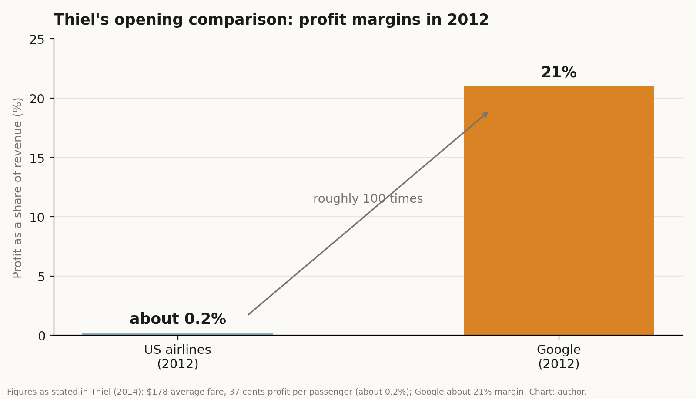
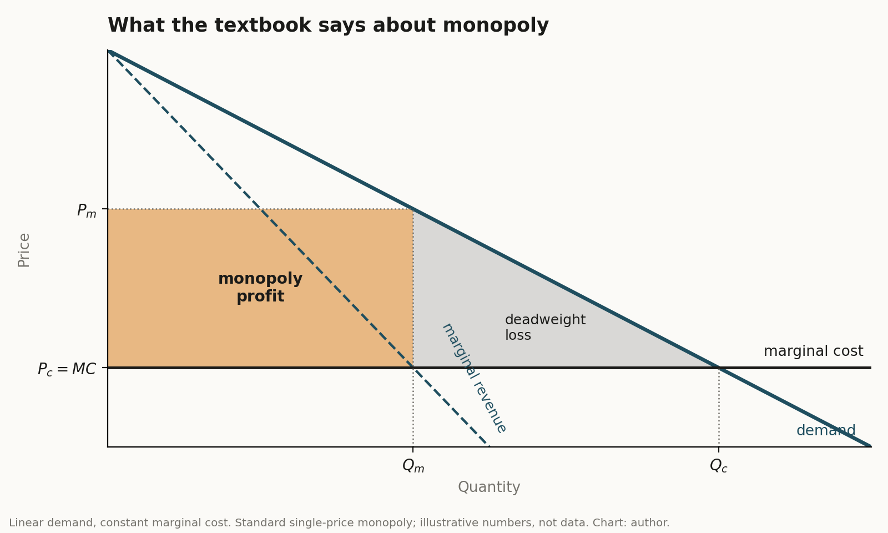
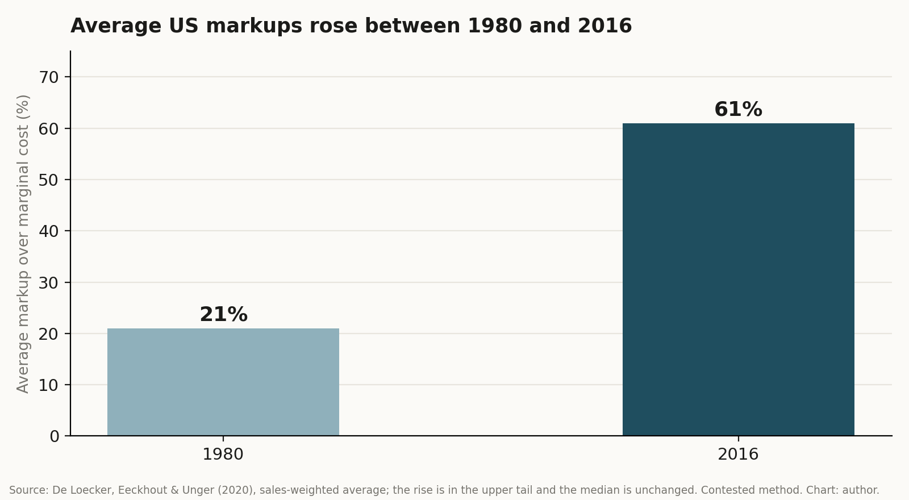

**Key points**

- In "Competition Is for Losers" (Wall Street Journal, 12 September 2014), Peter Thiel argues that competition erodes profit and that a lasting business should aim for a monopoly, meaning a firm with no close substitute (Thiel, 2014).
- His headline comparison holds up arithmetically: in 2012 US airlines earned about 0.2% on revenue and Google about 21%. But margins across industries with very different capital needs are a weak test of market power.
- Economists find his claim half right. Monopoly profit does reward innovation (Schumpeter, 1942), but the evidence says innovation peaks at intermediate competition, not at monopoly (Aghion et al., 2005).
- Twelve years later his main example is a federal antitrust finding, and market power has risen in the US economy, concentrated in a few high-markup firms (De Loecker et al., 2020).
- My reading: the essay is good advice for founders and an incomplete account of what is good for the economy.

## 1. Why I picked this essay

Thiel's essay is one of the most quoted pieces ever written about business strategy, partly because of its title. It was adapted from his book *Zero to One*, written with Blake Masters, and published in the Wall Street Journal's Saturday essay slot on 12 September 2014 (Thiel, 2014; Thiel & Masters, 2014). I am interested in digital markets, where questions about monopoly and competition keep returning, so I wanted to read the essay the way an economist would: check the numbers, compare the claim with theory, and ask what happened since.

## 2. What Thiel argues

The essay starts with a contrast. In 2012, an average US airline ticket cost $178 each way, and the airlines made 37 cents per passenger. Google that year brought in about $50 billion, against roughly $160 billion for the airline industry, and kept about 21% of it as profit, which is more than 100 times the airlines' margin (Thiel, 2014).

{: w="760" }
*Figure 1. The comparison that opens the essay, using the figures Thiel gives. His 37 cents on a $178 fare is about 0.2% of revenue, so the ratio to Google's 21% is roughly 100.*

His explanation uses the two textbook extremes. Under perfect competition, no firm earns an economic profit in the long run, because rivals compete it away. A monopoly is the opposite: with no rivals, it sets its own terms. His line is that capitalism and competition are opposites, because capitalism is about accumulating capital and competition prevents it (Thiel, 2014).

Two further points shape the essay. The first is a definition. By monopoly, Thiel means a company so good at something that no other firm can offer a close substitute. The second is a claim about how firms talk. Monopolists, he says, tend to downplay their position by describing themselves in the widest market they can find, and Google, which held about 68% of search in May 2014, calls itself a tech company, a market in which its share is tiny. Undifferentiated businesses do the reverse and exaggerate how unique they are. His practical advice to founders follows: find a small market, dominate it, then expand (Thiel, 2014).

He also makes a dynamic point. Monopoly is bad in a static world where nothing changes, he argues, but in a world where firms keep inventing, temporary monopoly profits are the reward that pays for invention (Thiel, 2014).

## 3. What the textbook says

On the facts of the model, Thiel is right. In the standard model, a competitive market ends with price equal to marginal cost and no economic profit, while a monopolist restricts quantity to raise price, earns a profit and causes a deadweight loss (Figure 2).

{: w="760" }
*Figure 2. The textbook picture. The amber rectangle is the monopoly's profit. The grey triangle is the surplus that disappears because the monopolist produces less than a competitive market would.*

The diagram also shows what the essay leaves out. The same monopoly profit that rewards the firm is paid for by buyers, and the triangle is a loss nobody collects. A careful reader should also note that "no economic profit" is not "no profit." Economic profit is what remains after paying capital its required return, so an airline can show a modest accounting profit and still sit at zero economic profit. That is why comparing raw margins across industries is a weak test. Airlines carry heavy capital and fuel costs, so their margins would be thin under any market structure, and a software-and-advertising firm carries far less. The comparison is vivid, but it does not isolate market power. This is my interpretation, not a claim from the essay.

## 4. Does monopoly drive innovation?

Thiel's dynamic argument has deep roots. Schumpeter (1942) argued that the prospect of temporary monopoly profit is what drives "creative destruction," the process in which new products displace old ones. Arrow (1962) pointed the other way: a firm already earning monopoly profit has less to gain from a new product that replaces its own, which is called the replacement effect, so a competitive firm may have more to gain from inventing.

The evidence sits between the two. Aghion et al. (2005) study firm-level data and find an inverted-U relationship: innovation is highest at an intermediate level of competition, because firms that are close to their rivals innovate to escape competition, while firms that are far ahead have less reason to. If that holds in digital markets, then neither "competition is for losers" nor "competition is always better" is the right slogan. The right question is how much rivalry is enough to keep the leader moving.

## 5. What happened to the Google example

Thiel used Google as his model of a firm with no close substitute and asked "a monopoly in what?" That question became the heart of a federal court case. On 5 August 2024, Judge Amit Mehta ruled that Google had unlawfully maintained a monopoly in general search and search text advertising, mainly through exclusive agreements that made it the default on many devices (Barker, 2024). In September 2025 he ordered remedies but declined to force the sale of Chrome, citing in part the rise of AI rivals (Hughes Hubbard & Reed, 2025; Silicon UK, 2026). Google appealed in January 2026, and the Justice Department and a majority of states cross-appealed in February, seeking stronger remedies (PYMNTS, 2026a, 2026b).

This cuts both ways for Thiel's argument. A court found that the monopoly was real and was kept in place by contracts and not only by product quality, which is the weak spot in the praise of monopoly. But the same court weighed whether AI products would erode that position, which fits his claim that monopolies are temporary when the economy keeps changing.

## 6. Is market power rising?

If monopoly is "the condition of every successful business," as the essay puts it, we should see it in the data. De Loecker et al. (2020) estimate that the average US markup over marginal cost rose from about 21% in 1980 to about 61% in 2016, with profit rates rising from about 1% to about 8%. The increase comes from the upper tail of firms, and the median is unchanged. Autor et al. (2020) find a related pattern, in which sales concentrate in "superstar firms" and the labor share of income falls.

{: w="760" }
*Figure 3. Sales-weighted average markup over marginal cost in the US. Source: De Loecker et al. (2020).*

That pattern matches Thiel's picture of a few firms with large margins. Two cautions apply. The markup estimates are contested, and a 2025 comment disputes them on sample-construction grounds (Benkard et al., 2025). And the same data show side effects the essay does not discuss, such as a lower labor share and less labor-market dynamism.

## 7. My view

This section is my own judgment.

I read the essay as excellent advice to a founder and an incomplete description of the economy. A founder who builds something with no close substitute has a better business than one who sells a commodity, and that part of the argument is hard to dispute. The step I would not make is from "good for the firm" to "good for the economy." The textbook says part of monopoly profit is a transfer from buyers and part is lost altogether, and the innovation literature says the benefit depends on how much pressure the leader still feels.

I also find the question "a monopoly in what?" the most useful sentence in the essay, because it is the question regulators and courts now argue about. How the market is defined often decides whether a firm looks dominant or small. In AI, I do not know which description will fit, and this is a hypothesis, not a finding: prices and capabilities in AI models change fast, which suggests contestability, while access to compute and distribution looks concentrated. Which force wins is a question I would want data on before taking a side.

Finally, I think the essay is stronger on incentives than on welfare. It explains why firms want monopoly very well. It says little about who pays and what happens when the monopolist stops innovating.

## 8. What would change my mind

- Evidence that high-markup firms are also the most innovative within their industries, which would support Thiel over Aghion's inverted-U.
- Evidence that Google's market share and margins fall significantly as AI search products grow, which would support the "temporary monopoly" reading.
- Return-on-capital data, not margins, showing that airlines and Google differ as much as the essay implies.

## 9. Limits of this post

I could not open the full Wall Street Journal text, which is paywalled. I worked from republished excerpts and secondary summaries of the essay, so the exact wording of his arguments should be checked against the original. The figures for airlines and Google are Thiel's own, not independently verified. The Google case is still on appeal, so the legal outcome is open. This is an educational discussion, not investment or legal advice.

## References

Aghion, P., Bloom, N., Blundell, R., Griffith, R., & Howitt, P. (2005). Competition and innovation: An inverted-U relationship. *The Quarterly Journal of Economics, 120*(2), 701-728.

Arrow, K. J. (1962). Economic welfare and the allocation of resources for invention. In National Bureau of Economic Research (Ed.), *The rate and direction of inventive activity: Economic and social factors* (pp. 609-626). Princeton University Press.

Autor, D., Dorn, D., Katz, L. F., Patterson, C., & Van Reenen, J. (2020). The fall of the labor share and the rise of superstar firms. *The Quarterly Journal of Economics, 135*(2), 645-709.

Barker, K. (2024). *United States v. Google LLC: A guide to the future of antitrust law in Big Tech*. University of Miami Law Review. https://lawreview.law.miami.edu/?p=7711

Benkard, C. L., Miller, D. P., & Yurukoglu, A. (2025). *Comment on "The rise of market power and the macroeconomic implications"* (NBER Working Paper No. 34513). National Bureau of Economic Research. https://www.nber.org/papers/w34513

De Loecker, J., Eeckhout, J., & Unger, G. (2020). The rise of market power and the macroeconomic implications. *The Quarterly Journal of Economics, 135*(2), 561-644. https://doi.org/10.1093/qje/qjz041

Hughes Hubbard & Reed. (2025). *Court issues remedies ruling in United States v. Google search case*. https://www.hugheshubbard.com/news/court-issues-remedies-ruling-in-united-states-v-google-search-case

PYMNTS. (2026a, January 18). *Google appeals landmark US antitrust ruling over search monopoly*. https://www.pymnts.com/cpi-posts/google-appeals-landmark-us-antitrust-ruling-over-search-monopoly/

PYMNTS. (2026b, February 4). *US Justice Department, states challenge Google antitrust remedies in appeal*. https://www.pymnts.com/cpi-posts/us-justice-department-states-challenge-google-antitrust-remedies-in-appeal/

Schumpeter, J. A. (1942). *Capitalism, socialism and democracy*. Harper & Brothers.

Silicon UK. (2026, February). *US Justice Dept, states appeal Google search remedies*. https://www.silicon.co.uk/e-regulation/legal/doj-states-google-appeal-628612/amp

Thiel, P. (2014, September 12). Competition is for losers. *The Wall Street Journal*. https://www.wsj.com/articles/peter-thiel-competition-is-for-losers-1410535536

Thiel, P., & Masters, B. (2014). *Zero to one: Notes on startups, or how to build the future*. Crown Business.
