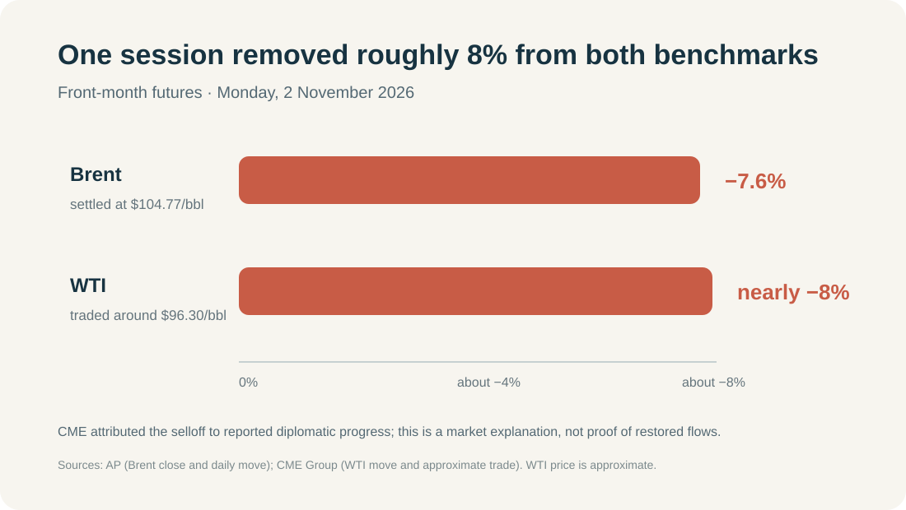
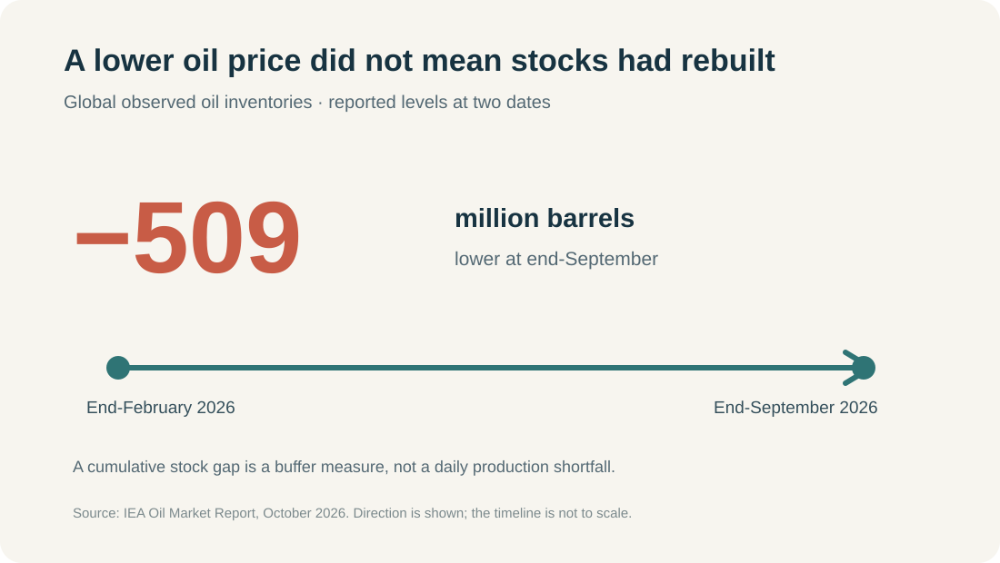
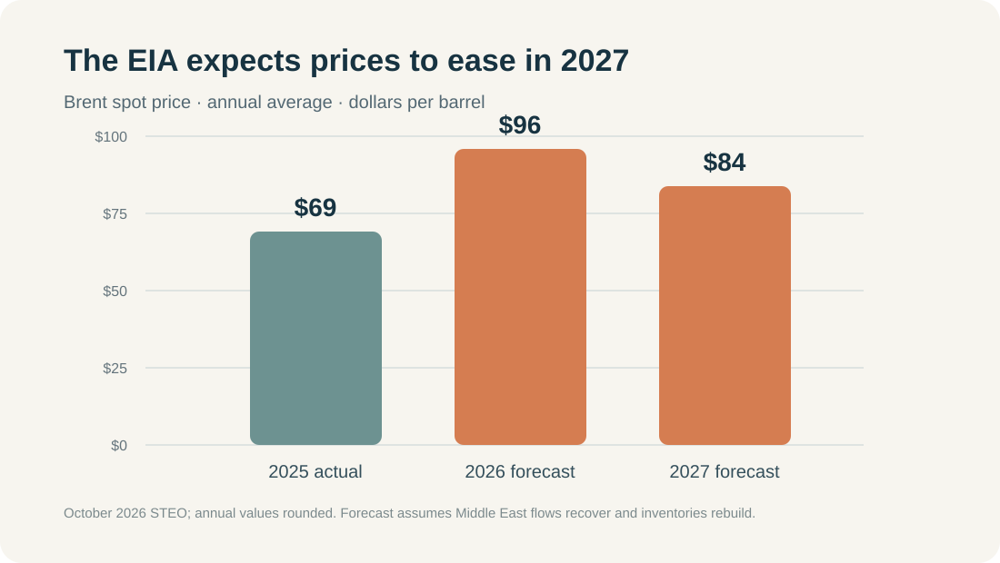

**Brent crude fell 7.6% on Monday, 2 November, to $104.77 a barrel. WTI dropped nearly 8%, trading around $96.30.** The speed of the fall makes it tempting to call the oil shock over. I would not go that far.

The clearest immediate explanation is a change in the market’s estimate of how long the supply disruption might last: CME Group’s market commentary tied the selloff to reported diplomatic progress between the United States and Iran. That is a plausible explanation for the move, not evidence that a durable agreement has been reached or that oil flows have returned to normal. [AP reported Brent’s price and daily decline](https://apnews.com/article/048328e49e47ce7afe6c1fb9d9acf13d); [CME’s 2 November commentary covered WTI and the market’s reading of the news](https://www.cmegroup.com/videos/2026/11/02/wti-crude-oil-futures-fall-8-as-geopolitical-risk-premium-fades.html).

My reading is that the market took some of the geopolitical risk premium out of prices. The physical market still looks tight in the near term. Whether this turns into a longer decline depends on actual export flows and inventory rebuilding.

{: w="1100" h="620" }

*Figure 1. Reported front-month futures move on 2 November. Brent’s $104.77 close and 7.6% decline are reported by AP. CME described WTI trading around $96.30, down nearly 8%; the WTI quote is approximate.*

## 1. What changed on 2 November?

The confirmed market fact is the size of the move: Brent lost 7.6% in a session and WTI fell by nearly 8%. CME said WTI had reached a five-and-a-half-month high in the previous session. The market commentary linked the reversal to reported diplomatic progress, which would lower the chance of a prolonged interruption to Middle Eastern exports.

That distinction matters. A peace process can change the price of risk before it changes the number of barrels available. Traders do not need to see tankers already moving normally to mark down the probability of a long disruption. But until those flows recover, that part of the price can return just as quickly.

The event is therefore a market interpretation, not a confirmed change in supply fundamentals. The daily price move tells us that expectations shifted sharply; by itself it cannot tell us whether the shift will last.

## 2. The near-term market is not obviously oversupplied

The latest IEA Oil Market Report, published on 14 October, describes a market still absorbing a large loss of stocks. Global observed oil inventories were 509 million barrels below their end-February level at the end of September. IEA also estimated that global stocks fell by 10 million barrels during September, as declining on-land inventories were only partly offset by more oil in transit. [IEA, Oil Market Report — October 2026](https://www.iea.org/reports/oil-market-report-october-2026).

There had been a recovery in Gulf crude exports during September. IEA said those flows were approaching pre-war levels, but warned that renewed attacks on regional energy infrastructure and tanker traffic threatened further recovery. In other words, barrels were coming back, but the route and the recovery remained vulnerable.

The EIA’s October outlook points in the same near-term direction. It estimated that global inventories fell by an average of 1.9 million barrels per day in the third quarter and projected another draw of 0.7 million barrels per day in the fourth quarter. Its forecast inputs were finalized on 1 October, before the diplomatic headlines that moved prices on 2 November. [EIA, Short-Term Energy Outlook — October 2026](https://www.eia.gov/outlooks/steo/).

{: w="1100" h="620" }

*Figure 2. This is a cumulative inventory difference, not a daily production shortfall. Source: IEA Oil Market Report, October 2026.*

At the 3 November cutoff, the next EIA Weekly Petroleum Status Report was scheduled for 4 November, so Monday’s price move had not yet been followed by a new weekly release. The [EIA schedule](https://www.eia.gov/petroleum/supply/weekly/schedule.php) lists its publication dates.

## 3. Demand is weakening too—and that matters more over time

The bearish case is not imaginary. The IEA expects global oil demand to fall by 2.6 million barrels per day on average in 2026, with a 2.5 million barrel-per-day year-on-year decline in the fourth quarter. It attributes much of that drop to restricted product availability, very high fuel prices, and a weaker economic outlook. Its forecast allows for a partial recovery in 2027, but leaves global oil use 0.6% below 2025 levels.

That is a feedback loop: the same disruption that makes oil scarce and expensive also destroys some demand. If prices stay high for long enough, consumers and businesses use less fuel, refiners adjust, and the market becomes less tight. That mechanism may help pull prices down even if supply routes reopen only gradually.

But this demand adjustment is a medium-term force, not proof that Monday’s sharp move was caused by a new demand report. The immediate catalyst identified by CME was the change in geopolitical expectations. I would keep those time horizons separate.

## 4. Forecasts point lower later, but they depend on flows recovering

The EIA’s October forecast puts Brent spot prices at an annual average of $96 per barrel in 2026 and $84 in 2027. It expects the fourth-quarter 2026 average to be about $105, then prices to ease as Middle Eastern flows recover and inventories rebuild. The EIA also flags continued volatility if exports through the Strait of Hormuz and alternative routes remain uncertain. [EIA, Short-Term Energy Outlook — October 2026](https://www.eia.gov/outlooks/steo/).

The IEA sees a similar turning point farther out: it projects global oil supply to rise by 7.7 million barrels per day in 2027 after falling in 2026, while demand partially recovers. That is a path toward a looser market if the recovery arrives. It is not a guarantee that it will.

{: w="1100" h="620" }

*Figure 3. EIA annual-average Brent spot prices in dollars per barrel. 2025 is historical; 2026 and 2027 are the October 2026 forecast. Values are rounded. Source: EIA.*

OPEC+ did not announce a fresh December production increase on 1 November. The seven participating countries said they would maintain the required production levels set for September 2026. That does not settle the longer-term supply question, but it means Monday’s decline was not paired with a new OPEC+ decision to add barrels. [OPEC+ statement, 1 November 2026](https://www.opec.org/pr-detail/620-1-november-2026.html).

There is also a useful timing caveat: the EIA outlook was completed on 1 October, and the next scheduled STEO release is 10 November. Its $84 forecast is a baseline built on earlier assumptions, not a direct response to the latest market move. OPEC+ says its next monthly review is scheduled for 29 November.

## 5. Three paths from here

| If we see… | The likely market reading |
|---|---|
| Sustained diplomatic progress, visibly recovering export and transit flows, and inventories starting to rebuild | The risk premium can shrink further; prices would have room to fall. |
| Talks continue but flows recover slowly or unevenly | A choppy market is the most plausible outcome: diplomatic headlines pull prices down, while tight stocks and shipping risk limit the decline. |
| Talks break down or attacks disrupt exports and shipping again | The premium can return quickly, especially while inventories remain below pre-conflict levels. |

These are scenarios, not price targets. The next evidence I would watch is measurable: vessel traffic and exports through the Strait of Hormuz and bypass routes, global stock changes, and the direction of diesel prices and refining margins. Those indicators can show whether the market is moving from “less risk” to “more supply.”

## My view

I see 2 November as a repricing of how long the disruption may last, rather than proof that the market has already moved into a surplus. That reading is supported by the size and timing of the futures move, and by CME’s explanation. The inventory data and both agencies’ near-term balances argue for caution about calling the shock finished.

I lean toward continued volatility with a modest downward bias if exports keep recovering. The key word is “if.” A headline can remove some risk premium in minutes; rebuilding stocks and restoring reliable flows takes longer. If those flows stall, oil can regain part of Monday’s decline without any change in the longer-run demand picture.

---

## Sources

- [CME Group — WTI crude oil futures fall nearly 8%, 2 November 2026](https://www.cmegroup.com/videos/2026/11/02/wti-crude-oil-futures-fall-8-as-geopolitical-risk-premium-fades.html)
- [AP — Brent crude fell 7.6% to $104.77, 2 November 2026](https://apnews.com/article/048328e49e47ce7afe6c1fb9d9acf13d)
- [IEA — Oil Market Report, October 2026](https://www.iea.org/reports/oil-market-report-october-2026)
- [U.S. EIA — Short-Term Energy Outlook, October 2026](https://www.eia.gov/outlooks/steo/)
- [OPEC — Seven OPEC+ countries maintain December production requirements, 1 November 2026](https://www.opec.org/pr-detail/620-1-november-2026.html)
- [U.S. EIA — Weekly Petroleum Status Report schedule](https://www.eia.gov/petroleum/supply/weekly/schedule.php)

*This is market analysis, not a trading recommendation.*
