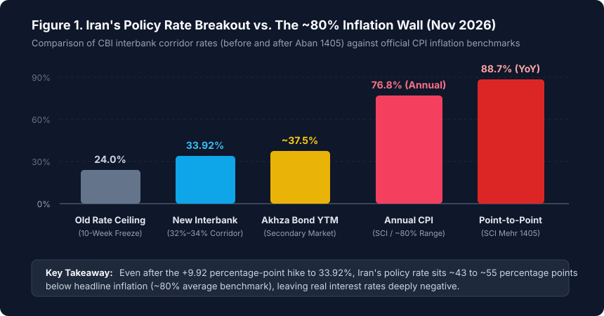
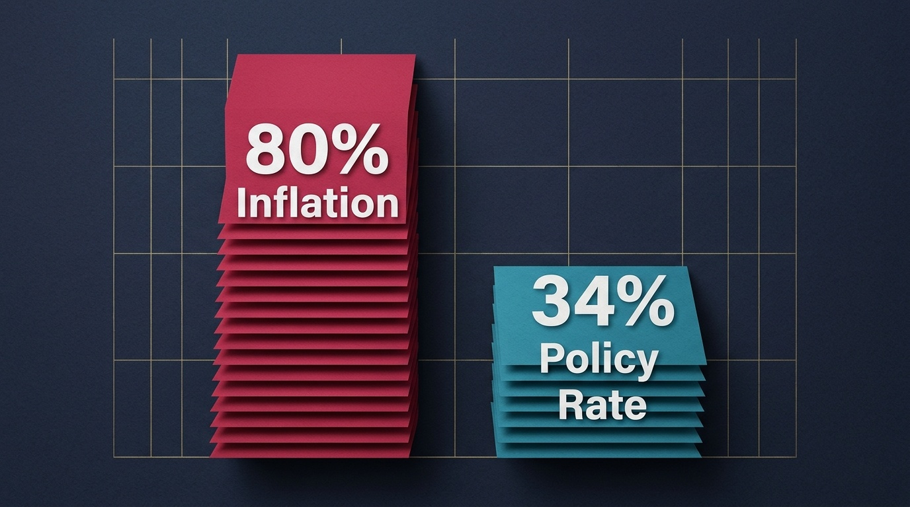
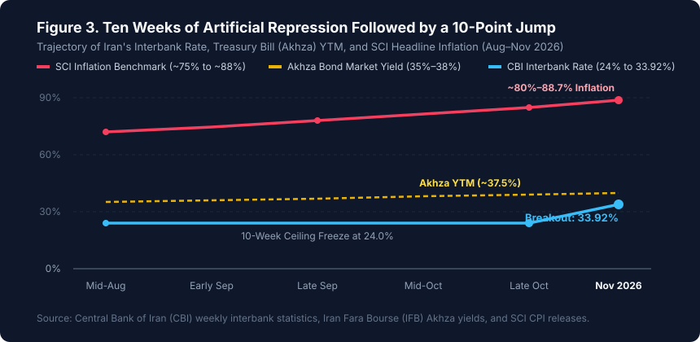
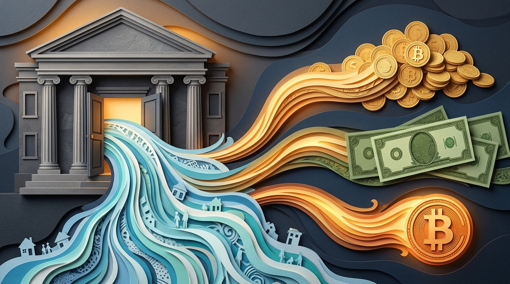
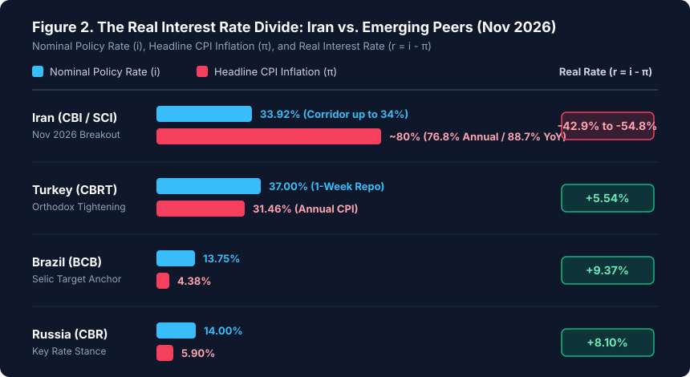

**Iran's weighted average interbank interest rate surged by nearly 10 percentage points in early November 2026 (Aban 1405), jumping from a frozen ceiling of 24.0% to 33.92%. Simultaneously, the Central Bank of Iran (CBI) shifted its policy rate corridor upward, lifting the standing credit facility ceiling to 34% and the minimum open-market repo rate to 32%.** The sheer size of the single-week adjustment makes it tempting to call this a hawkish monetary turnaround. I would not go that far—even though I view the decision itself as both welcome and dangerously overdue.

The clearest explanation for the sudden breakout is that the 24% administrative cap had completely detached from Iran's macroeconomic reality. While the interbank rate was held flat for ten consecutive weeks between late August and late October, headline consumer price inflation surged into the **80% range**—with the Statistical Centre of Iran (SCI) reporting annual national inflation at **76.8%** and point-to-point year-on-year inflation at **88.7%** for the month ending late October (Mehr 1405), alongside a **71.4%** annual urban figure from the CBI itself.

My reading is that the Central Bank did not suddenly convert to textbook hawkishness; rather, the bond market and commercial bank overdrafts forced its hand. Raising the policy corridor to 34% is the right move because freezing nominal rates during an 80% inflation wave does not protect domestic production—it subsidizes speculative credit arbitrage. Whether this 10-point hike actually cools monetary expansion depends on whether policymakers close the remaining gap in real rates and rein in fiscal dominance.

*Figure 1. Comparison of the Central Bank of Iran's policy rate corridor before and after early November 2026 (Aban 1405) against secondary-market Treasury Bill (Akhza) yields and official CPI inflation benchmarks. Sources: CBI and SCI.*

---

## 1. What changed in early November — and why the 24% ceiling broke

For ten weeks leading up to November, the CBI kept the interbank market rate tightly pinned at 24.0%. On paper, that stability was presented as an anchor for corporate borrowing costs. Beneath the surface, liquidity pressures inside the banking network were building rapidly.

In the first week of Aban 1405 (early November 2026), the central bank abandoned that ceiling in a single step:

* **Standing Credit Facility Ceiling (نرخ اعتبارگیری قاعده‌مند):** Raised by 10 percentage points, from **24% to 34%**.
* **Open Market Operations (OMO) Minimum Repo Rate (نرخ ریپو):** Raised by 9 percentage points, from **23% to 32%**.
* **Weighted Average Interbank Rate (نرخ بازار بین‌بانکی):** Jumped from roughly **24.0% to 33.92%** within one reporting cycle.

Why did the ceiling break so abruptly? Because an administrative cap on interbank money cannot survive indefinitely when the market-clearing price of liquidity is more than 12 percentage points higher. Throughout autumn 2026, yields to maturity (YTM) on government Islamic Treasury Bills (*Akhza*) traded on the Iran Fara Bourse had already climbed into the **36% to 38%** band.

When the central bank lends to commercial banks at 23%–24% while risk-free government paper yields 37% and inflation sits near 80%, the central bank's discount window ceases to be a lender of last resort. It becomes the cheapest source of funding in the country. Banks face a strong incentive to exhaust central bank credit lines rather than mobilize retail deposits or liquidate assets, expanding the monetary base ($M_0$) and feeding the exact inflationary spiral the cap was meant to prevent. By moving the corridor to 32%–34%, the CBI narrowed the gap between its official window and the bond market's reality.

---

## 2. The 80% inflation reality: Reading the official SCI and CBI data

To evaluate whether a 34% policy rate is tight or loose, we have to measure it against current price dynamics rather than past nominal rates. Both of Iran's official statistical agencies released CPI reports for Mehr 1405 (the Iranian month ending late October 2026) that paint a stark picture of accelerating price pressures around the **80% mark**:

1. **Statistical Centre of Iran (SCI / مرکز آمار ایران):** Placed 12-month average national inflation at **76.8%**, while point-to-point inflation (comparing October 2026 prices directly with October 2025) reached **88.7%**. In rural areas, where food and basic goods carry a heavier basket weight, point-to-point inflation crossed into triple digits at **107%**.
2. **Central Bank of Iran (CBI / بانک مرکزی):** Reported 12-month average urban inflation at **71.4%**. More tellingly, the CBI's monthly inflation series showed steady acceleration across the third quarter: from **3.7%** in Mordad to **3.9%** in Shahrivar, and **4.6%** in Mehr. A 4.6% monthly pace compounds to an annualized run rate above **71%**.

*Editorial visual: Even after a 10-percentage-point rate hike to 34%, the nominal policy rate remains less than half the ~80% headline inflation rate.*

In monetary economics, the stance of policy is never measured by the nominal interest rate ($i$) alone. It is measured by the **real interest rate** ($r$), defined by the Fisher equation:

$$1 + r = \frac{1 + i}{1 + \pi} \implies r \approx i - \pi$$

where $\pi$ represents expected or headline inflation. Using ~80% as the composite headline inflation benchmark between the SCI's 76.8% annual rate and 88.7% point-to-point rate:

* **Before the November hike ($i = 24\%$):** The real policy interest rate stood around **$-56\%$** (or **$-47.4\%$** using the CBI's 71.4% series).
* **After the November hike ($i = 33.92\%$):** The real policy interest rate remains between **$-42.9\%$** (against 76.8% annual SCI inflation) and **$-54.8\%$** (against 88.7% YoY SCI inflation).

*Figure 3. The widening spread between Iran's CPI inflation benchmark (~80%), secondary-market Treasury bill yields (~37.5%), and the interbank rate prior to the November breakout. Sources: CBI, SCI, and IFB.*

In other words, a 33.92% nominal interest rate looks high only if we suffer from *money illusion*. In real purchasing-power terms, monetary conditions in Iran remain deeply negative.

---

## 3. Why policy rates must exceed inflation: The Taylor Principle and expectations

A recurring objection in domestic policy debates is that raising interest rates during high inflation merely increases working-capital costs for factories, pushing prices even higher (the "cost-channel" argument). Why does mainstream central banking—backed by decades of empirical evidence—insist that nominal policy rates must rise above the inflation rate?

The answer lies in the **Taylor Principle**, formulated by John Taylor (1993) and embedded at the core of the New Keynesian framework pioneered by **Robert Hall and Michael Woodford** (whose foundational work on expectations and stabilization policy earned the 2026 Nobel Prize in Economic Sciences). Under a standard Taylor Rule specification:

$$i_t = r^* + \pi_t + \alpha_{\pi}(\pi_t - \pi^*) + \alpha_y(y_t - \bar{y}_t)$$

For inflation to have a unique, stable equilibrium, the policy response coefficient on excess inflation must satisfy $\alpha_{\pi} > 0$, meaning $\frac{\partial i_t}{\partial \pi_t} = 1 + \alpha_{\pi} > 1$. When inflation rises by 10 percentage points, the central bank must raise the nominal policy rate by *more* than 10 percentage points so that the real interest rate ($r_t = i_t - E_t[\pi_{t+1}]$) increases.

As Woodford's *Interest and Prices* demonstrated, when a central bank violates the Taylor Principle—keeping $\frac{\partial i_t}{\partial \pi_t} < 1$ or freezing nominal rates outright—real interest rates *fall* whenever inflation expectations rise. Lower real rates make borrowing even more profitable in real terms, accelerating credit demand, money creation, and self-fulfilling inflationary expectations.

While the cost channel exists in the short run for working-capital-dependent firms, empirical macroeconomics shows that the **demand and expectations channel** dominates by a wide margin once inflation crosses 30%–40%. A manufacturer paying 34% on a loan when output prices are rising at 80% is still receiving a massive net real subsidy on borrowed principal.

---

## 4. Behavioral economics and domestic academic evidence: The arbitrage trap

The case for higher nominal rates becomes even clearer when we look at household and corporate behavior through the lens of **Behavioral Economics** and domestic empirical research from the **Faculty of Economics at the University of Tehran** and **Sharif University of Technology (GSME)**.

*When real deposit rates sit at -45%, loss aversion drives households to treat bank balances as melting ice, accelerating liquidity flight into FX, gold, and crypto.*

Three behavioral and institutional distortions dominate when nominal interest rates are repressed far below inflation:

### A. Loss aversion and the velocity of money
Under **Kahneman and Tversky's Prospect Theory**, economic agents feel the pain of a guaranteed purchasing-power loss roughly twice as intensely as the pleasure of an equivalent gain. When official deposit rates sit between 20.5% and 30% while inflation runs near 80%, holding Rial balances in a bank guarantees a loss of roughly 45% to 50% of real wealth per year.

In that environment, converting bank deposits into gold coins, foreign exchange (USD/USDT), durable goods, or real estate is not "irrational speculation"—it is rational loss avoidance. This behavioral flight increases the **velocity of money ($V$)** in the quantity equation ($MV = PY$). Even if money supply ($M$) grew at a constant pace, a rising velocity of circulation independently drives up the price level ($P$). Raising interest rates slows velocity by reducing the penalty for holding interest-bearing Rial instruments.

### B. Credit rationing and the rent-seeking subsidy
Monetary researchers at the **University of Tehran** and **Sharif University** have long documented what happens when statutory bank lending rates are capped below inflation in Iran. Suppose a corporate borrower secures a 100 billion Toman facility at an official rate of 23%–28% while inflation is 80%. At the end of twelve months, the nominal repayment is 123–128 billion Tomans, while the real value of any physical inventory, imported input, or real asset purchased with that loan has risen to roughly 180 billion Tomans.

That **52 to 57 percentage-point spread** is an immediate, risk-free wealth transfer from depositors and money-holders to whoever obtains the loan. The consequences are predictable:
1. **Chronic excess demand for credit:** Every firm wants unlimited loans at -45% real interest, forcing banks to ration credit through political connections or collateral rather than project productivity.
2. **Diversion from production to non-productive assets:** Working capital is quietly diverted into inflation hedges, real estate, or supply hoarding because the return on holding inventory beats manufacturing margins.
3. **Illiquid bank balance sheets:** Because borrowers have every incentive to delay repayment (letting 80% inflation erode the real principal of their debt), banks face chronic cash-flow freezes and turn back to the CBI's overdraft window.

---

## 5. International evidence: How Turkey, Brazil, and Russia used positive real rates

Iran is not the first economy to wrestle with the political temptation of keeping interest rates low during high inflation. Across emerging markets between 2022 and 2026, central banks that enforced **positive real interest rates ($r > 0$)** succeeded in bending the inflation curve downward, while those that experimented with rate cuts under high inflation triggered currency crises.

*Figure 2. Cross-country comparison of nominal policy rates, headline CPI inflation, and implied real interest rates as of November 2026. Sources: CBI, SCI, CBRT, BCB, and Bank of Russia.*

| Country | Central Bank | Policy Rate (Nov 2026) | Headline CPI Inflation | Real Policy Rate ($r \approx i - \pi$) | Policy Regime |
| :--- | :--- | :--- | :--- | :--- | :--- |
| **Iran** | CBI | **33.92%** (Corridor 32–34%) | **~80%** (76.8% Ann. / 88.7% YoY) | **-42.9% to -54.8%** | Repressed / Negative Real Rate |
| **Turkey** | CBRT | **37.00%** | **31.46%** | **+5.54%** | Orthodox Disinflation Pivot |
| **Brazil** | BCB | **13.75%** | **4.38%** | **+9.37%** | Credibility & Expectations Anchor |
| **Russia** | CBR | **14.00%** | **5.90%** | **+8.10%** | Demand-Cooling Tightening |

### The Turkish natural experiment (CBRT)
Turkey provides the closest modern laboratory for Iranian policymakers. Between 2021 and mid-2023, Turkish authorities explicitly pursued the thesis that "high interest rates cause high inflation," cutting the policy rate to 8.5% while inflation soared past 75% and the Lira collapsed.

In mid-2023, the Central Bank of the Republic of Türkiye (CBRT) reversed course entirely. It hiked the one-week repo rate aggressively to a peak of **50%** in 2024–2025, absorbing excess Lira liquidity and restoring foreign exchange reserves. Only after annual inflation fell from over 75% into the low 30s did the CBRT begin measured rate cuts—holding the policy rate at **37.0%** against **31.46%** inflation in late 2026 to maintain a strict **+5.54% positive real buffer**.

### Brazil (BCB) and Russia (CBR)
Brazil's central bank (Banco Central do Brasil) learned the lessons of chronic inflation decades ago. Even with annual inflation contained around **4.38%**, the BCB maintains its benchmark Selic rate at **13.75%**—a **+9.37% real interest rate**—to keep fiscal expansion from unanchoring medium-term price expectations. Similarly, the Bank of Russia (CBR) pushed its key rate above 18%–21% during its peak wartime demand surge before easing to **14.0%** against **5.9%** inflation, maintaining an **+8.10% real rate**.

---

## 6. Why 34% is still a half-measure: Fiscal dominance and the deposit gap

Supporting the CBI's move from 24% to 34% does not mean ignoring its structural limitations. As studies by the **Majlis Research Center (مرکز پژوهش‌های مجلس)** and monetary economists at **Sharif University** emphasize, Iran's inflation is rooted in **fiscal dominance (تسلط مالی)** and banking-sector imbalance (*Natarazi*). Two bottlenecks still threaten the effectiveness of this rate hike:

1. **The Retail Deposit Disconnect:** Lifting the interbank rate to 33.92% raises the cost of wholesale funding between banks, yet standard retail deposit rates remain administratively capped far below both the 34% interbank rate and the ~80% inflation rate (outside periodic, limited-quota 30% certificates of deposit). If ordinary households do not receive a competitive return on bank savings, rising interbank rates alone will not stop deposit outflows into Tether (USDT), gold funds, and physical FX.
2. **Inelastic Bad Banks and Budget Deficits:** A healthy banking system responds to a 34% central bank penalty rate by curtailing loan growth and shrinking its balance sheet. However, deeply insolvent banks (*بانک‌های ناتراز*) have price-inelastic liquidity demand—they must borrow from the CBI at *any* interest rate simply to clear daily settlement obligations. If the central bank charges 34% without forcing structural resolution or halting government deficit financing through the banking network, those interest charges compound exponentially on paper, eventually expanding the monetary base.

---

## 7. Three paths from here

| If we see… | The likely macroeconomic and market reading |
| :--- | :--- |
| **The CBI pairs the 34% corridor with higher retail deposit yields, stricter balance-sheet caps on insolvent banks, and reduced fiscal overdrafts** | Monthly inflation momentum (currently 4.6% MoM) can begin to decelerate over a 2–3 quarter horizon, narrowing the spread between parallel FX/USDT rates and official yields. |
| **The interbank rate stays at 34%, but retail deposit caps remain frozen and the government forces banks to absorb massive year-end budget deficits** | Stagflationary pressure: productive private firms face tighter working-capital credit at 34%+, while base money still expands via state-mandated lending and bank overdrafts, keeping inflation pinned in the 70%–85% range. |
| **Political pressure from industrial lobbies forces the CBI to reverse the hike and push the interbank ceiling back down toward 24%–26%** | Immediate loss of monetary credibility; bond markets freeze, OMO injections surge, and household liquidity rushes aggressively back into gold, FX, and crypto. |

These are conditional policy trajectories, not point forecasts. Over the coming weeks, the measurable indicators I will watch are the **weekly volume of CBI open-market repo injections**, the **secondary-market YTM on short-dated Akhza bills**, **monthly base-money ($M_0$) growth**, and whether the Central Bank authorizes **new high-yield deposit instruments** for retail savers.

---

## My view

I agree with the Central Bank's decision to break the 24% interbank rate ceiling and push the policy corridor to 34%. Freezing nominal interest rates in the low 20s while headline inflation runs near 80% was never a pro-production policy—it was an administrative fiction that punished savers, rewarded leveraged rent-seekers, and forced the central bank to inject cheap base money into the banking system.

My criticism is timing and completeness. Waiting ten weeks while point-to-point inflation climbed to 88.7% allowed inflationary expectations to harden across goods, housing, and currency markets. Moreover, a 33.92% nominal rate against ~80% inflation still leaves the real interest rate below **-40%**. 

Moving from 24% to 34% is a welcome step toward monetary realism. It acknowledges that the price of money cannot be decreed by circular when inflation is running at four times that level. But until Iran's monetary authorities allow real returns to move closer to positive territory—and until fiscal discipline stops forcing the banking system to monetize state deficits—this rate hike remains a brake pedal pressed only halfway down on a steep downhill grade.

---

## Sources

* **Central Bank of Iran (CBI)** — *Weekly Interbank Market & Open Market Operations (OMO) Statistics, Aban 1405 (November 2026)*, reporting the shift in the policy corridor to 32%–34% and weighted interbank rate at 33.92%.
* **Statistical Centre of Iran (SCI / درگاه ملی آمار)** — *National Consumer Price Index (CPI) Report, Mehr 1405 (October/November 2026)*, reporting 76.8% annual national inflation and 88.7% point-to-point inflation.
* **Central Bank of Iran (CBI)** — *Urban Consumer Price Index Report, Mehr 1405*, reporting 71.4% 12-month urban inflation and 4.6% monthly inflation.
* **Faculty of Economics, University of Tehran (*Journal of Economic Research / تحقیقات اقتصادی*) & Sharif University of Technology (GSME)** — Empirical literature on credit rationing, negative real interest rates, and fiscal dominance in the Iranian banking system.
* **Central Bank of the Republic of Türkiye (CBRT)**, **Banco Central do Brasil (BCB)**, and **Bank of Russia (CBR)** — *Monetary Policy Committee (MPC) Decisions and CPI Releases, October–November 2026*.
* **Taylor, J. B. (1993)** — *"Discretion versus policy rules in practice,"* Carnegie-Rochester Conference Series on Public Policy; and **Woodford, M. (2003)** — *Interest and Prices: Foundations of a Theory of Monetary Policy*, Princeton University Press.

*This is macroeconomic analysis, not a financial or trading recommendation.*
